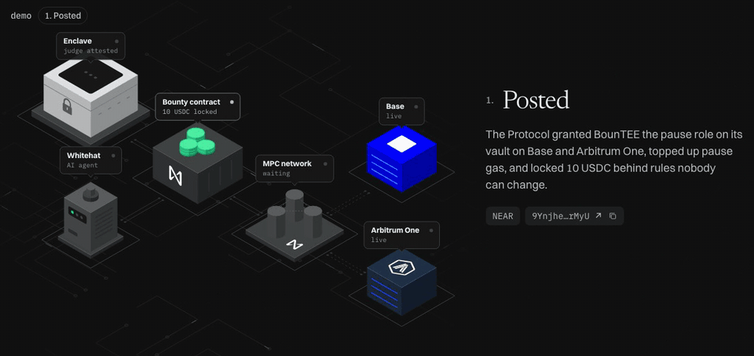
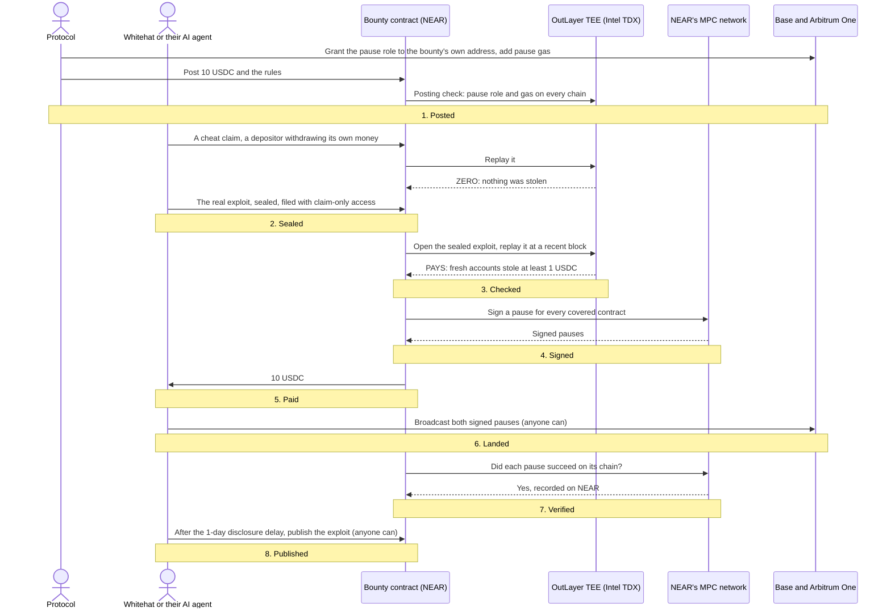
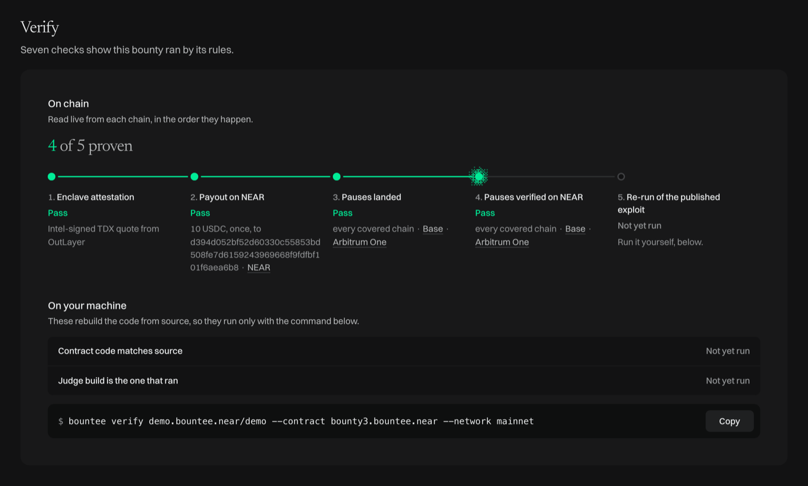
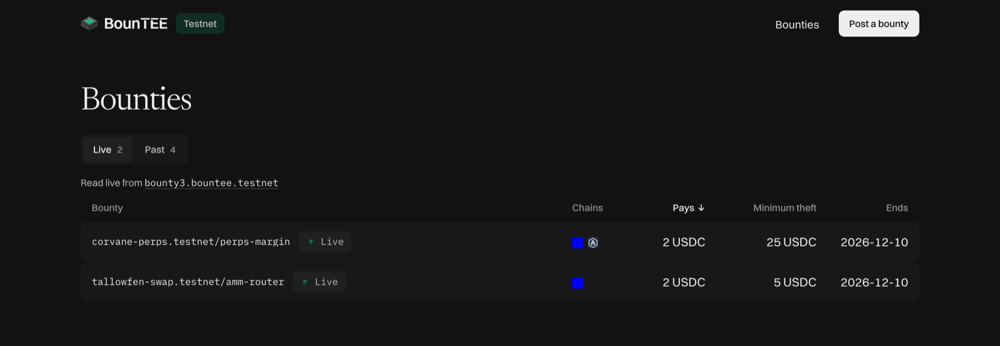
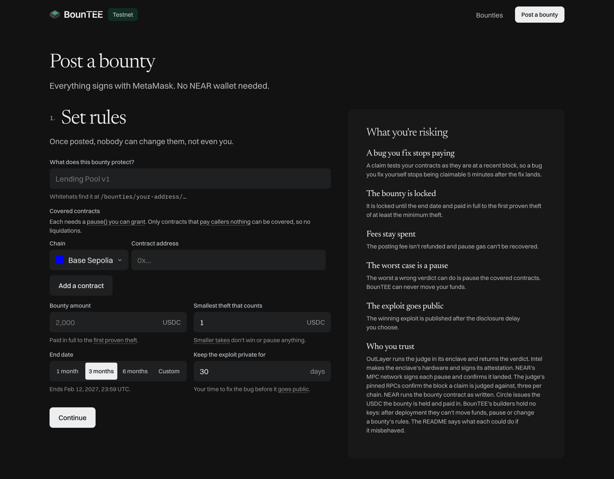
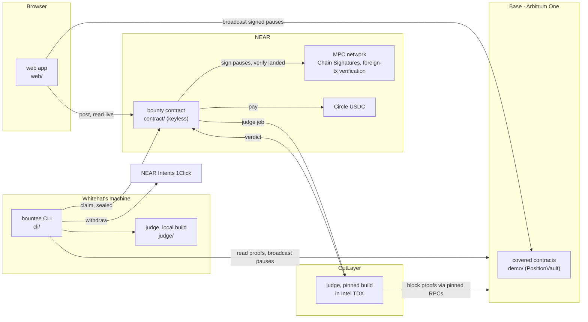
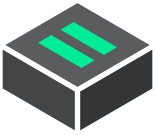

<div align="center">

<picture>
  <source media="(prefers-color-scheme: dark)" srcset="brand/bountee-lockup-on-dark.svg">
  
</picture>

### Prove it. Get paid. Pause it on Base and Arbitrum One.

Bug bounties that pay themselves. A Whitehat, or their AI agent, seals an exploit and a TEE replays it. If the exploit is proven, NEAR pays them and signs a pause on every chain the bounty covers.

[](https://nearblocks.io/address/bounty3.bountee.near)
[](https://nearblocks.io/txns/6xbAxbuABt1i2f37YQobnCpot1iuSfUfKKRSih5nV5DL)
[](https://api.outlayer.ai/attestations/by-tx/6xbAxbuABt1i2f37YQobnCpot1iuSfUfKKRSih5nV5DL)
[](https://basescan.org/tx/0xdb51859768a260f5b151540cdec806e45cf8e0367c4c9cea9fa2bd910a184eb3)
[](https://arbiscan.io/tx/0x74c9e4b697a61ca0512a3bee5a016adc45cc1190c081ed669ab6e1db37158573)
[](contract/)
[](cli/)
[](LICENSE)

[Demo video](<!-- PENDING: demo video URL -->) · [Live site](<!-- PENDING: mainnet site URL -->) · [Try it on testnet](<!-- PENDING: testnet site URL -->) · [How it works](#how-it-works) · [Mainnet proof](#mainnet-proof) · [Hackathon tracks](#hackathon-tracks) · [Check every claim](#check-every-claim-yourself) · [Architecture](#architecture) · [Roadmap](#roadmap)

<br>



<sub>The landing page plays the mainnet demo, step by step, with each step's transaction read live from the chains.</sub>

</div>

## Who it's for

- **Protocols** that want to pay out only when an exploit is proven. A Protocol posts a bounty in USDC and grants the bounty the right to pause its contracts when a bug has been reproduced.
- **Whitehats** who want to prove an exploit without revealing it: it stays sealed until they're paid. A Whitehat can file claims themselves or let an AI agent file them with claim-only access, which can't move their money.

## The problem

Protocols spend a lot of time and money on bug reports that turn out to be false: the bug they describe can't be reproduced. AI tools now write these reports at almost no cost, so the pile only grows. When a report is real, the bug is live: the contracts can be drained on every chain they're deployed on, and nothing stops an attacker until someone at the Protocol reads the report and acts.

Whitehats have a problem of their own. They hand over the exploit before they're paid, and after that the Protocol can downgrade its severity or delay payment.

BounTEE replaces the report with a proof. The exploit stays sealed while a TEE replays it against the chain's recent state. If it steals at least the minimum the Protocol set from the covered contracts, the bounty contract on NEAR pauses them on every chain and pays the Whitehat the whole bounty. Only then can the Protocol open the exploit.

## Why NEAR

BounTEE depends on NEAR for five things, and each one ran on mainnet.

| Promise | What on NEAR keeps it | Mainnet evidence |
|---|---|---|
| Nobody, including the Protocol and me, can take the bounty or block a valid payout | A **keyless contract**, `bounty3.bountee.near`, holds the USDC and the right to request pauses. Its account has no access keys, so only its code can move funds. | [Deployed and every key deleted, in one transaction](https://nearblocks.io/txns/G6ZavFnd7ASg6tLqCmVdS769CvTYtxJag7B48H46VN5o) |
| One proven exploit pauses the covered contracts on every chain | **Chain Signatures**: the contract asks NEAR's MPC network to sign a `pause()` from the bounty's own address on Base and on Arbitrum One. | [Pauses signed](https://nearblocks.io/txns/6xbAxbuABt1i2f37YQobnCpot1iuSfUfKKRSih5nV5DL) · [landed on Base](https://basescan.org/tx/0xdb51859768a260f5b151540cdec806e45cf8e0367c4c9cea9fa2bd910a184eb3) · [landed on Arbitrum One](https://arbiscan.io/tx/0x74c9e4b697a61ca0512a3bee5a016adc45cc1190c081ed669ab6e1db37158573) |
| A pause recorded as verified really landed | **MPC foreign-chain transaction verification**: NEAR's MPC network checks each pause on its chain, and the contract records it on NEAR. | [Base verified](https://nearblocks.io/txns/Bu4ka3vWnys4t5S11aM3Mh2RKGpr1CBsiVRrtchMEWFL) · [Arbitrum One verified](https://nearblocks.io/txns/8ZpdsJiH8xZF4UWb6nxzRCMRp2hJAvMEUThdnQ2GJHWx) |
| An AI agent can claim for a Whitehat without being able to move the Whitehat's money | A **function-call access key**: the Whitehat's account grants permission to call only the contract's two claim methods, and NEAR itself refuses anything else. | [Claim-only access granted](https://nearblocks.io/txns/4YqsBZMxzhrEdvN38tRR6tQsQtXc3gsFiAoMNwmjeGRM) · [the agent's claim, paid](https://nearblocks.io/txns/6xbAxbuABt1i2f37YQobnCpot1iuSfUfKKRSih5nV5DL) |
| The exploit stays sealed until the payout | **OutLayer** runs BounTEE's judge, the program that replays each claim, in a TEE (Intel TDX). Only jobs the bounty contract requests can open a sealed exploit. | [Attestation of the winning claim](https://api.outlayer.ai/attestations/by-tx/6xbAxbuABt1i2f37YQobnCpot1iuSfUfKKRSih5nV5DL) · [a copied exploit refused](https://nearblocks.io/txns/26BsCqZhbRNCjQfjLPmNvbHz7X7CnR5sEpat9jPk9bGT) (the transaction succeeds, but OutLayer's log in it reads `Access denied by access condition`) |

## How it works

Every bounty goes through eight steps. The diagram below walks through a typical journey, from the Protocol's setup, through a claim that isn't a real bug and pays nothing, to the real exploit paid.



1. **Posted.** The Protocol grants the pause role on each chain to an address only the bounty contract can sign for, funds that address with gas for the pauses, and posts the bounty. A TEE job checks the grants and the gas before the bounty goes live.
2. **Sealed.** The Whitehat seals their exploit so only the bounty contract's own TEE jobs can read it, then submits it to the bounty contract to claim the bounty.
3. **Checked.** The TEE replays the exploit's transactions against the chain's state at a block at most 5 minutes old. If the exploit steals at least the minimum the Protocol set from the covered contracts, the Whitehat gets paid; if not, they get nothing.
4. **Signed.** NEAR's MPC network signs one `pause()` per covered contract, from the bounty's pause-role address.
5. **Paid.** The contract sends the whole bounty to the Whitehat. The payout never waits for the pauses to land.
6. **Landed.** Anyone can broadcast the signed pauses; the Whitehat's command-line tool does it at once.
7. **Verified.** NEAR's MPC network checks that each pause succeeded on its chain, and the contract records it.
8. **Published.** After the disclosure delay the Protocol chose (1 to 90 days), anyone can publish the exploit, and then anyone can re-run it to check the payout was earned.

## Mainnet proof

Everything here is on mainnet: NEAR, Base and Arbitrum One.

| Account | Address |
|---|---|
| Bounty contract (keyless) | [`bounty3.bountee.near`](https://nearblocks.io/address/bounty3.bountee.near) |
| Protocol | [`demo.bountee.near`](https://nearblocks.io/address/demo.bountee.near) |
| Whitehat | [`d394d052…f6aea6b8`](https://nearblocks.io/address/d394d052bf52d60330c55853bd508fe7d6159243969668f9fdfbf101f6aea6b8) |
| Pause-role address, the same on both chains | [`0x1a36e8fd…215316c8` on Base](https://basescan.org/address/0x1a36e8fd8a9a1861647c05e4fc44294c215316c8) · [on Arbitrum One](https://arbiscan.io/address/0x1a36e8fd8a9a1861647c05e4fc44294c215316c8) |
| Demo vault on Base | [`0xd64ee488…a3ba8cb3`](https://basescan.org/address/0xd64ee488b95be262f2539086fd703362a3ba8cb3) |
| Demo vault on Arbitrum One | [`0xb9b4395c…e421ad9e`](https://arbiscan.io/address/0xb9b4395cda6c5980e584914eeb408f06e421ad9e) |

The demo bounty is `demo.bountee.near/demo`:

- **Bounty:** 10 USDC
- **Minimum theft:** 1 USDC
- **In each chain's vault:** 2 USDC
- **Disclosure delay:** 1 day
- **Vault code:** [`demo/src/PositionVault.sol`](demo/src/PositionVault.sol)

| Step | Mainnet transactions |
|---|---|
| Posted | [9Ynjhen1…9XqkrMyU](https://nearblocks.io/txns/9Ynjhen18G4aUgaDyvw2Q2EiVLg4vnuD9pCo9XqkrMyU) |
| Sealed | [6xbAxbuA…ih5nV5DL](https://nearblocks.io/txns/6xbAxbuABt1i2f37YQobnCpot1iuSfUfKKRSih5nV5DL) |
| Checked | [6xbAxbuA…ih5nV5DL](https://nearblocks.io/txns/6xbAxbuABt1i2f37YQobnCpot1iuSfUfKKRSih5nV5DL) (paid) · [7Jzy9kK8…AtHcXaFG](https://nearblocks.io/txns/7Jzy9kK8a8FTrpUiTDsQKvtqFruHuvYprteNAtHcXaFG) (the cheat, nothing paid) |
| Signed | [6xbAxbuA…ih5nV5DL](https://nearblocks.io/txns/6xbAxbuABt1i2f37YQobnCpot1iuSfUfKKRSih5nV5DL) |
| Paid | [6xbAxbuA…ih5nV5DL](https://nearblocks.io/txns/6xbAxbuABt1i2f37YQobnCpot1iuSfUfKKRSih5nV5DL) |
| Landed | [Base 0xdb518597…0a184eb3](https://basescan.org/tx/0xdb51859768a260f5b151540cdec806e45cf8e0367c4c9cea9fa2bd910a184eb3) · [Arbitrum One 0x74c9e4b6…37158573](https://arbiscan.io/tx/0x74c9e4b697a61ca0512a3bee5a016adc45cc1190c081ed669ab6e1db37158573) |
| Verified | [Base Bu4ka3vW…tchMEWFL](https://nearblocks.io/txns/Bu4ka3vWnys4t5S11aM3Mh2RKGpr1CBsiVRrtchMEWFL) · [Arbitrum One 8ZpdsJiH…nQ2GJHWx](https://nearblocks.io/txns/8ZpdsJiH8xZF4UWb6nxzRCMRp2hJAvMEUThdnQ2GJHWx) |
| Published | [ErRTXzQW…cw6d7hf1](https://nearblocks.io/txns/ErRTXzQWFSJxXbfkqC3LFeXvNU1SjijzFeicw6d7hf1) |

Sealed, Checked, Signed and Paid share one NEAR transaction: the claim was filed, judged, signed and paid inside it.

### The Whitehat's AI agent

In this demo, the Whitehat's AI agent filed the winning claim, the Sealed-to-Paid transaction above. The agent went in blind: no memory, no web, and only claim-only access to the Whitehat's account. It found the bug in the demo vault, proved it with `bountee test` and claimed the bounty all on its own. For further evidence, its launch script, instructions and full transcript are in [`docs/demo-agent-run/`](docs/demo-agent-run/README.md); its exploit is the one in the Published step above. Its claim-only access was [granted](https://nearblocks.io/txns/4YqsBZMxzhrEdvN38tRR6tQsQtXc3gsFiAoMNwmjeGRM) before the run and [revoked](https://nearblocks.io/txns/7MRzr5uabDfqE3rjFKAQwpQzwjk8845E6s643gT3q9nm) after it.

A Whitehat can also claim themselves; both paths are under [As a Whitehat](#as-a-whitehat).

## Check every claim yourself

No keys or funds needed: every claim above can be checked from a clean checkout.

You need Node 22.18 or later, pnpm, the Rust toolchain in `rust-toolchain.toml` with the `wasm32-wasip2` target, and [wasmtime](https://wasmtime.dev). The last step also needs Docker. From the repo root:

```sh
pnpm install
cargo build --release -p bountee-judge --target wasm32-wasip2   # the judge the TEE runs
alias bountee='node cli/src/main.ts'                           # in a script, use `pnpm bountee`
```

Then one command runs every step below and checks its output: `node scripts/check-readme-steps.ts`. Steps 1 to 3 need no network.

**1. A real exploit pays, and a cheat pays nothing.** These replay recorded claims through the judge you just built, against an earlier demo vault, [`demo/src/DemoVault.sol`](demo/src/DemoVault.sol). In the cheat, a depositor withdraws its own money: funds leave the vault, but nothing is stolen.

```console
$ bountee test --job demo/fixtures/exploit.json
verdict: PAYS (minimum_theft_reached)
$ bountee test --job demo/fixtures/cheat.json
verdict: ZERO (below_minimum_theft)
```

**2. The judge isn't tuned to my demo.** Three [Damn Vulnerable DeFi](https://www.damnvulnerabledefi.xyz) v4 levels, each with an exploit that pays and a cheat that doesn't.

```console
$ bountee test --job demo/fixtures/dvd/truster-exploit.json
verdict: PAYS (minimum_theft_reached)
$ bountee test --job demo/fixtures/dvd/truster-cheat.json
verdict: ZERO (below_minimum_theft)
$ bountee test --job demo/fixtures/dvd/side-entrance-exploit.json
verdict: PAYS (minimum_theft_reached)
$ bountee test --job demo/fixtures/dvd/side-entrance-cheat.json
verdict: ZERO (below_minimum_theft)
$ bountee test --job demo/fixtures/dvd/puppet-exploit.json
verdict: PAYS (minimum_theft_reached)
$ bountee test --job demo/fixtures/dvd/puppet-cheat.json
verdict: ZERO (below_minimum_theft)
```

**3. A real historical hack pays.** The June 2023 DEPUSDT/LEVUSDC hack, replayed against Ethereum mainnet's real state at the block before it.

```console
$ bountee test --job cli/test/fixtures/historical/depusdt-levusdc.json
verdict: PAYS (minimum_theft_reached)
block: 17484161
```

**4. The bounty contract holds no keys.** This reads mainnet with no account.

```console online
$ curl -s https://free.rpc.fastnear.com -H 'content-type: application/json' -d '{"jsonrpc":"2.0","id":1,"method":"query","params":{"request_type":"view_access_key_list","finality":"final","account_id":"bounty3.bountee.near"}}'
"keys":[]
```

**5. The demo's winning exploit, re-run on your machine.** `rerun` fetches the published exploit and the proofs its claim put on NEAR, replays them without contacting Base, and compares with the TEE's verdict (the tool labels it `enclave`).

```console online
$ bountee rerun demo.bountee.near/demo --contract bounty3.bountee.near --network mainnet
verdict: PAYS (minimum_theft_reached)
enclave: PAYS (minimum_theft_reached)
same verdict as the enclave
```

**6. Rebuild the contract and judge, and check the whole demo bounty.** `verify` rebuilds the contract and the judge from the commit the deployment names, in Docker, and compares their hashes with what ran. It checks the TEE's attestation against Intel's certificates, the payout, each pause's landing and its verified record on NEAR, and re-runs the published exploit under the rebuilt judge. The rebuild takes about 10 minutes.

<!-- PENDING: tag mainnet-bounty3 pushed to GitHub, then drop `pending` from the block below -->
```console online pending
$ bountee verify demo.bountee.near/demo --contract bounty3.bountee.near --network mainnet
pass contract_code
pass judge_build
pass attestation
pass payout
pass pause_landed
pass pause_verified
pass rerun
no check failed
```



<sub>The same checks on the demo bounty's mainnet page; the rebuild and re-run happen only with the command above.</sub>

## Known gaps

- **Not audited by a third party.** My own audit found no critical or high issues, and its five known issues are listed in [docs/audit.md](docs/audit.md). They stay unfixed so the demo runs the build the full rehearsal ran. The audit covered the build first deployed as `bounty.bountee.near`, not the later changes that let `bounty3.bountee.near` take a claim proven on any covered chain.
- **No admin, no upgrades.** If NEAR's MPC network changes its interface so pauses can't be signed, or Circle blocklists the winner, that bounty is stuck and its USDC stays locked.
- **The contract trusts OutLayer's result.** It doesn't check the TEE's attestation itself; anyone can check it afterwards with `bountee verify`.
- **One payout per bounty, EVM chains only.** A bounty pays its first proven exploit and closes. Each claim is proven on one covered chain, so an exploit that needs two chains' state at once can't be judged.
- **The demo bounty is deliberately small:** 10 USDC (see [Mainnet proof](#mainnet-proof)).

## Use it

> [!IMPORTANT]
> The testnet site is for trying BounTEE with no real money: NEAR testnet, Base Sepolia and Arbitrum Sepolia. Nothing on it is evidence; the proof above is all mainnet.

The testnet site <!-- PENDING: testnet site URL --> runs the same web app against `bounty3.bountee.testnet`, which takes Circle's testnet USDC and holds no keys.



<sub>The bounty list on the testnet site, read from <code>bounty3.bountee.testnet</code>.</sub>

### As a Whitehat

The testnet site's Live bounties cover a vault with a real bug. Find it, prove it and claim the bounty's test USDC. Each bounty pays only its first win.

You need the setup from [Check every claim yourself](#check-every-claim-yourself) and [Foundry](https://getfoundry.sh).

1. `bountee init` creates a testnet account and funds it from NEAR's faucet.
2. Pick a Live bounty on the testnet site. Its page lists each covered contract and its chain. The vault's source is [`demo/src/PositionVault.sol`](demo/src/PositionVault.sol).
3. Write your exploit as a Foundry script. Its `run()` broadcasts the attack and sends the stolen tokens to `msg.sender`, from a fresh account with no role on any contract ([details](docs/agent-instructions.md#steps), step 3).
4. `bountee test <script> --bounty <protocol>/<name> --chain <chain> --contract bounty3.bountee.testnet --network testnet` runs the judge on your machine, so you know the result before you spend anything. `--chain` is needed when a bounty covers more than one chain. The first run can take a few minutes.
5. When it says PAYS, `bountee claim <script> --bounty <protocol>/<name> --chain <chain> --contract bounty3.bountee.testnet --as <your account> --network testnet` seals the exploit, files it and shows each step live until the pauses are verified, which can take up to half an hour. Each claim costs about 0.3 testnet NEAR, whatever the result. You get a receipt with every transaction.

### With your AI agent

Your AI agent can find the bug and claim for you with claim-only access: it can call only `submit_claim` and `retry_claim`, can't move your money, and every win is paid to your account.

Before it starts, follow [For the Whitehat: before you hand over](docs/agent-instructions.md#for-the-whitehat-before-you-hand-over): put `bountee` on the agent's PATH, top up your claim balance (the agent can't), and grant claim-only access with `bountee key add`. Then give the agent that folder and [docs/agent-instructions.md](docs/agent-instructions.md). `bountee key revoke` withdraws the access afterwards.

### As a Protocol

You need an Ethereum wallet that can sign on NEAR (MetaMask, Rabby, Zerion, or Brave Wallet in Brave) with testnet ETH on each chain you cover, and a pausable contract you control on Base Sepolia or Arbitrum Sepolia. Testnet NEAR and USDC come from faucets the app links in step 4.

1. Open the testnet site and press **Post a bounty**.
2. **Set rules.** Name what the bounty protects, add each contract and its chain, and set the **Bounty amount**, the **Smallest theft that counts** and how long to **Keep the exploit private for**. The **What you're risking** panel beside the form says what you're committing to.
3. **Set up pause.** Press **Connect wallet**. For each chain, press **Grant** to give the pause role to the bounty's pause-role address (or **Copy for multisig** if a multisig owns the contract), then send that address its pause gas. Each task ticks off once it lands.
4. **Add funds.** Your NEAR account is your wallet's address. Send it the bounty's USDC and NEAR for the posting fee and gas. Each ticks off once it arrives.
5. **Post bounty.** **Sign with your wallet** to make your exploit key, so only you can open the winning exploit. Then **Enable NEAR signing**, **Prepay the posting fee** (0.5 NEAR, not refunded), and **Post the bounty**. The bounty goes Live once the posting check passes.



<sub>Set rules, with the "What you're risking" panel, on the testnet site.</sub>

## Architecture



| Folder | What it is | What it does |
|---|---|---|
| [`contract/`](contract/) | The bounty contract (Rust, near-sdk) | Holds bounties and their USDC, requests judge jobs, asks NEAR's MPC network to sign pauses, pays the Whitehat, records verified pauses, publishes exploits |
| [`judge/`](judge/) | The judge (Rust, revm, compiled to WebAssembly) | Replays a claim against proven chain state and returns PAYS, ZERO or INVALID. The same build runs locally and in the TEE |
| [`cli/`](cli/) | The `bountee` command-line tool (TypeScript, near-api-js) | Tests, claims, verifies, re-runs, publishes and withdraws |
| [`web/`](web/) | The web app (Next.js, wagmi, viem) | Shows the landing page, bounty list and bounty pages with Verify, runs the posting flow, and broadcasts signed pauses |
| [`demo/`](demo/) | The demo contracts (Solidity, Foundry) and recorded jobs | The vaults the demo bounty covers, and the jobs that [Check every claim yourself](#check-every-claim-yourself) replays |
| [`formats/`](formats/) | Shared formats | Defines the data both Rust and TypeScript read |
| [`scripts/`](scripts/) | The README checker and test scripts | Runs every README step and checks its output, links and step table |
| [`docs/`](docs/) | Project documents | [Requirements](docs/requirements.md), [spec](docs/spec.md), [decisions](docs/adr/), [agent instructions](docs/agent-instructions.md), [the agent's run](docs/demo-agent-run/README.md). Terms are in [GLOSSARY.md](GLOSSARY.md) |

## Threat model

### What counts as an exploit

A claim can be proven on any chain the bounty covers: it names that chain and a recent block on it. Replay the claim's transactions, sent only by fresh accounts, against that chain's state at that block. **Gain** is what the fresh accounts (and contracts they create) end up holding, minus the seed they started with. **Loss** is what the covered contracts on that chain lost. Both count only the tokens listed for that chain, at prices fixed when the bounty was posted. The score is the smaller of the two. At or above the minimum theft it **PAYS**; below it, **ZERO**. A malformed claim, a transaction from an existing account, or a read of state the claim didn't prove is **INVALID**. A win pauses every covered contract on every covered chain, whichever chain it was proven on.

So a depositor's own withdrawal, an owner rescue, a sweep to the treasury, a swap or flash loan in a pool the bounty doesn't cover, and an unsold mint all score zero.

### Who you trust, and what each could do

| Party | Trusted for | If it misbehaved |
|---|---|---|
| **OutLayer** (its operator, its upgradeable contract, and the one-member DAO that governs its keystore and approves TEE builds) | Running the pinned judge in the TEE and returning its verdict; opening sealed exploits only in jobs the bounty contract asks for | Could forge a verdict; the worst a forged verdict can do is pause the covered contracts and pay one bounty. Could read sealed exploits, or refuse to run jobs (claims then wait, unpaid and unjudged). A forged verdict is caught afterwards by the attestation, the rebuilt judge hash and the re-run of the published exploit (`bountee verify`). |
| **Intel** (TDX hardware and attestation) | The TEE really isolates the judge, and its attestation is genuine | A broken TEE or forged attestation could leak sealed exploits or forge verdicts, with the same worst case as above. The re-run of the published exploit doesn't depend on Intel. |
| **NEAR's MPC network** (Chain Signatures and foreign-chain verification) | Signing the bounty's pauses, and checking that they landed | Could sign other transactions from a bounty's pause address, but the pause role can only pause: it can't unpause or move funds. Could refuse to sign (a winning claim waits, unpaid), or record as verified a pause that didn't land (the payout never depends on it, and anyone can check the chain). |
| **The RPCs pinned in the judge's build** (three per chain; at least two must answer and all answers must agree) | Confirming the claim's block hash, and reading each chain at posting | Two colluding RPCs, with the third unreachable, could confirm a fake block, letting a claim be judged against invented state: a forged verdict. One RPC alone can only stall a claim. |
| **NEAR** (its validators) | Running the bounty contract as written | The same trust as any NEAR contract. |
| **Circle** (the USDC issuer) | USDC keeps its value and stays transferable | Could blocklist the bounty contract or the winner on NEAR's USDC (its contract has `blocklist` and `is_blocklisted`), freezing their USDC. |
| **BounTEE's builder** (me) | Nothing after deployment | The contract holds no keys, so I can't move funds, pause, or change a bounty's rules. I chose the judge and its pinned RPCs at deployment; both are open source here, and `verify` rebuilds them and compares the hashes that ran. |
| **The Protocol** | Its own contracts | Can revoke the pause role, upgrade its contracts or fix the bug: a valid claim is still paid, and a fix ends new claims on that chain (see Timing). Can't withdraw the bounty before its end date or while a claim is unresolved. A Protocol insider planting a bug and claiming it themselves is not something BounTEE can prevent, as on any bounty platform. |

Nobody needs to trust the Whitehat, the broadcaster of a signed pause (anyone can send it; nobody can change it) or the explorer `verify` uses to find transactions (every transaction is read again from NEAR RPC).

<details>
<summary><strong>Timing</strong></summary>

- **Recency window: 5 minutes.** A claim is judged against the state of the chain it's proven on, at a block no more than 5 minutes older than the claim. A bug the Protocol fixes on a chain stops being claimable there 5 minutes after the fix lands; it stays claimable on a chain where it isn't fixed.
- **Exposure window: about 10 seconds on the demo.** A PAYS verdict is public on NEAR, so from then until the pauses land, a watcher knows a covered contract has a bug, though not what it is.

This time comes from the block timestamps of the transactions in the [step table](#mainnet-proof).
</details>

<details>
<summary><strong>Stated limits</strong></summary>

- **A pause protects only the covered contracts.** Copies of the same code deployed elsewhere stay exposed.
- **Publishing the exploit exposes those copies further.** Winning exploits are published after the disclosure delay the Protocol chose at posting (1 to 90 days).
- **Payouts are open to anyone, with no allowlist or KYC (identity checks).** Circle, USDC's issuer, can blocklist an account on NEAR's USDC, which would freeze a sanctioned winner's payout.
- **Anyone can post a bounty on a copy of someone else's code**, to get a working exploit of it. Granting the pause role proves control of the covered contracts, not authorship of the code in them.
- **A failed claim reveals its read set, never its exploit.** The claim's proofs go on NEAR, so anyone can see which fresh addresses and storage slots it touched.
- **"Paused" means the pause transaction succeeded on that chain, as verified by NEAR's MPC network.** It is not a claim about what the contract's code does when paused.
- **The replay doesn't reproduce every chain exactly.** On Arbitrum, the block-number opcode returns an Ethereum block number on chain but the Arbitrum block's own number in the replay, and Arbitrum's system contracts (such as `ArbSys`) and Stylus (WebAssembly) contracts don't exist in the replay. Base runs the instructions of Ethereum's Osaka upgrade, but the replay uses the earlier Prague upgrade's rules. A contract that depends on any of these may replay differently from how it runs on its chain.
</details>

<details>
<summary><strong>Coverage limit</strong></summary>

**Only contracts that pay nothing to callers by design can be covered.** An AMM pool (an automated exchange), a lending market that pays liquidation bonuses, or a contract that pays keeper rewards hands value to fresh accounts as part of normal use, so the rule would count it as theft. Cover the contracts that hold funds and pay out only to their owners. Such pools can still appear in an exploit as dependencies, where value taken from them never counts.

Also out of scope: bugs where nobody profits (locked funds, denial of service, insolvency), attacks needing several blocks or time to pass, attacks needing a victim's later transaction, theft of users' approvals from their own wallets, and chains NEAR's MPC network can't verify (Base and Arbitrum One can).
</details>

## Similar projects

Bounties that pay on a proven exploit aren't new in crypto. Two come closest:

- **HoneyPause** (a winner at ETHDenver 2024): an on-chain exploit bounty tied to a circuit breaker. The exploit runs in public, and only its own chain pauses. BounTEE keeps the exploit sealed until the payout and pauses every covered chain.
- **Sealed-Glass Proofs** (Tramèr et al., 2017): showed that a TEE can prove a bug exists, for a fair-exchange bounty. BounTEE turns that idea into a working bounty, live on mainnet.

What neither has is what NEAR makes possible: one keyless contract that holds the bounty, pauses the covered contracts on every chain through Chain Signatures, and lets an AI agent claim with claim-only access ([Why NEAR](#why-near)).

## Roadmap

After the hackathon, BounTEE grows in two phases: first hardening what's live, then reaching more chains and more users.

### Phase 1: Hardening

| Deliverable | How I'll know it worked |
|---|---|
| A third-party audit of the bounty contract, with the five known issues fixed in a new deployment that is still keyless | Report published; every high and critical issue fixed |
| The bounty contract checks the TEE's attestation itself, so nobody has to trust OutLayer's result | A forged result is refused on chain |
| One or two pilot Protocols posting small live bounties | The first bounty posted by someone other than me, paid or ended |

### Phase 2: Reach

NEAR's MPC network already signs and verifies all of these chains on mainnet (`v1.signer`'s `get_available_foreign_chains`).

| Deliverable | How I'll know it worked |
|---|---|
| Fund a bounty from any chain through NEAR Intents | A bounty posted with USDC that started on another chain |
| Solana: BounTEE adds a Solana replay to the judge | One proven exploit pauses a Protocol's Solana program alongside its EVM contracts |
| More EVM chains: BNB Chain, Polygon, Avalanche | A bounty covering one of them, judged and paused |
| A web claim screen, so a Whitehat doesn't need the command line | A claim filed and paid from the browser |

### Sustainability

The 0.5 NEAR posting fee covers only BounTEE's on-chain costs, so today it earns nothing. To pay for itself, the Protocol would pay a small service fee on top of the bounty at posting; the Whitehat still gets the whole bounty, and the contract stays keyless.

### How NEAR could help

A few things would help most: support funding the audit and an introduction to an auditor, a line to the OutLayer and MPC teams, and introductions to Protocols deployed on several chains who'd try it as pilots.

## Hackathon tracks

Built for the NEAR hackathon (October to November 2026), for two tracks:

- **Security** ("AI Security & Defense: trust, but verify"). BounTEE uses all three of the track's hints: an AI agent claims with claim-only access (a NEAR **function-call access key**), and anyone can check the **TEE attestation** of each result with `bountee verify`. The transactions are in the last two rows of [Why NEAR](#why-near).
- **Privacy.** The exploit stays sealed until the Whitehat is paid: only the bounty contract's own TEE jobs can read it, and a copy sent to OutLayer directly is refused. The transaction is in the last row of [Why NEAR](#why-near).

## Run the tests

`pnpm test` runs every suite. Each test names the requirements it proves ([docs/requirements.md](docs/requirements.md)).

| Suite | Command | Proves |
|---|---|---|
| Shared formats | `pnpm test:formats` | Rust and TypeScript read the same data |
| Judge | `pnpm test:j` | the payout rule, scenario by scenario |
| Command-line tool | `pnpm test:t` | the `bountee` tool, against local stand-ins |
| Web app | `pnpm test:w` | the web app, in Playwright |
| Demo contracts | `pnpm test:e` | the demo vaults and Damn Vulnerable DeFi levels |
| Bounty contract | `pnpm test:c` | the bounty contract, in NEAR's sandbox (the slowest suite) |

## Built with, and disclosures

| Used for | Libraries |
|---|---|
| The bounty contract | near-sdk |
| The judge's EVM | revm, alloy-trie, alloy-rlp |
| NEAR calls | near-api-js |
| The web app | Next.js, React, wagmi, viem, TanStack Query, RainbowKit |
| Cryptography | @noble/curves, @noble/hashes, @noble/ciphers, @scure/base; x25519-dalek, chacha20poly1305, hkdf, k256, sha2, sha3 (Rust) |
| Demo contracts | OpenZeppelin Contracts, Foundry |
| Tests | Vitest, Playwright |

- **Damn Vulnerable DeFi** v4 (MIT): three of its levels are used as judge tests and, with a pause added, as offline demo contracts. See [`demo/dvd/NOTICE`](demo/dvd/NOTICE).
- **DeFiHackLabs** (Apache-2.0): the historical replay reproduces its DEPUSDT/LEVUSDC exploit.
- **AI coding agents** wrote much of the code and documentation, under my review.
- **Feasibility tests:** six throwaway tests ran on testnets before the build (Oct 31 to Nov 2). None of their code is in this repo.

MIT licensed. See [LICENSE](LICENSE).

<div align="center">
<br>

<br>
<sub>BounTEE · proven on NEAR mainnet</sub>
</div>
